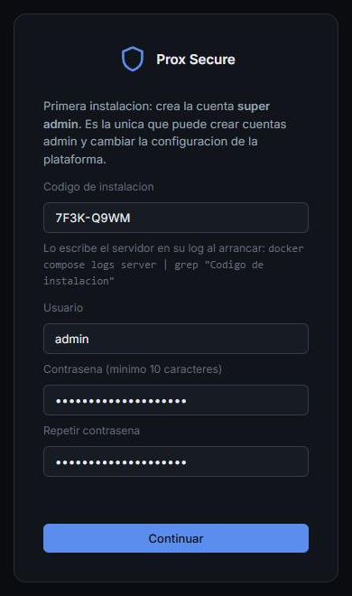

# Manual de instalación de Shinji SOC

Esta guía lleva de cero a una instalación funcionando: el servidor con el panel, HTTPS, la cuenta de administración con MFA y los agentes en los servidores que quieres vigilar.

- [1. Cómo está armado](#1-cómo-está-armado)
- [2. Requisitos](#2-requisitos)
- [3. Instalar el servidor](#3-instalar-el-servidor)
- [4. Primer ingreso: la cuenta super admin](#4-primer-ingreso-la-cuenta-super-admin)
- [5. HTTPS](#5-https)
- [6. Agregar servidores (agentes)](#6-agregar-servidores-agentes)
- [7. Cerrar el acceso sin cifrar](#7-cerrar-el-acceso-sin-cifrar)
- [8. Configuración opcional](#8-configuración-opcional)
- [9. Respaldos](#9-respaldos)
- [10. Actualizar](#10-actualizar)
- [11. Quitar un servidor o desinstalar todo](#11-quitar-un-servidor-o-desinstalar-todo)
- [12. Solución de problemas](#12-solución-de-problemas)
- [13. Migrar desde Prox Secure](#13-migrar-desde-prox-secure)

---

## 1. Cómo está armado

```
 Servidores vigilados                     Servidor de Shinji SOC (Docker)
 ┌──────────────────┐   HTTPS (443)     ┌──────────────────────────────────┐
 │ agente           │ ───────────────►  │ caddy   HTTPS delante del panel  │
 │ (systemd, Python)│   métricas, logs, │ server  panel + API (FastAPI)    │
 └──────────────────┘   inventario      │ db      PostgreSQL + TimescaleDB │
 ┌──────────────────┐                   │ ollama  IA local                 │
 │ agente           │ ───────────────►  │ backup  respaldos de la base     │
 └──────────────────┘                   └──────────────────────────────────┘
```

- **El servidor** corre en Docker: el panel web, la base de datos, la IA local, HTTPS y los respaldos.
- **El agente** se instala en cada servidor Linux que quieres vigilar. Manda métricas, logs de acceso, inicios de sesión SSH y el inventario de paquetes, y ejecuta los bloqueos que apruebas en el panel. Siempre es el agente el que se conecta al servidor, nunca al revés.

## 2. Requisitos

### Servidor de Shinji SOC

| | Mínimo | Comentario |
|---|---|---|
| Sistema | Linux con Docker Engine y Docker Compose v2, o Windows/macOS con Docker Desktop | Probado en Windows 11 con Docker Desktop. |
| Memoria | 6 GB libres para Docker | Medido: Ollama ocupa 3,4 GiB con el modelo `qwen2.5:3b` cargado; el resto de los contenedores, unos 250 MiB. |
| Disco | 20 GB | Medido: imágenes 11,5 GB (Ollama 8,5 GB), modelo 1,9 GB, base GeoIP 50 MB, más la base de datos y los respaldos. |
| CPU | 4 núcleos | La IA corre en CPU; no hace falta GPU. Con una GPU la IA responde más rápido. |
| Red | Puertos 80 y 443 libres | Los agentes se conectan al 443. |

### Servidores que vas a vigilar

- Debian, Ubuntu o derivados (usa `apt` y `systemd`). Probado en Proxmox VE 8 (Debian 13).
- Acceso como `root` (o `sudo`).
- Que puedan llegar al servidor de Shinji SOC por el puerto 443 (o el 8000 sin HTTPS).

El instalador agrega solo lo que falte: `python3`, `python3-venv`, `python3-pip`, `sudo`, `fail2ban` y `acl`.

## 3. Instalar el servidor

**1. Descarga el código**

```bash
git clone https://github.com/Andy1218100/Shinji-SOC.git
```

```bash
cd Shinji-SOC
```

**2. Crea el archivo de configuración**

```bash
cp .env.example .env
```

Edita `.env` y cambia como mínimo:

- `POSTGRES_PASSWORD`: una contraseña larga para la base de datos.
- `SESSION_SECRET_KEY`: la clave que firma las sesiones.

Para generar valores al azar:

```bash
openssl rand -hex 32
```

Todo lo demás se puede dejar como está y ajustar después desde el panel, en **Configuración**.

> **Importante:** el `.env` contiene contraseñas y claves. No lo subas a ningún repositorio (ya está en `.gitignore`).

**3. Levanta los contenedores**

```bash
docker compose up -d --build
```

La primera vez tarda varios minutos: descarga unos 11 GB de imágenes.

**4. Descarga el modelo de IA**

```bash
docker compose exec ollama ollama pull qwen2.5:3b
```

Son 1,9 GB. Sin el modelo, el panel funciona igual, pero los eventos y las vulnerabilidades no tienen explicación de la IA.

> **Por qué este modelo:** en una PC sin GPU, `llama3.1:8b` tardó unos 9 minutos en una sola respuesta, y `qwen2.5:3b` responde en segundos. Si tu servidor tiene GPU, puedes elegir un modelo más grande en Configuración > Inteligencia artificial.

**5. Comprueba que todo esté corriendo**

```bash
docker compose ps
```

Los cinco servicios (`db`, `ollama`, `server`, `caddy`, `backup`) tienen que aparecer como `Up`, y `db` como `healthy`.

## 4. Primer ingreso: la cuenta super admin

**1. Busca el código de instalación.** El servidor lo escribe en su log al arrancar, mientras no exista ninguna cuenta:

```bash
docker compose logs server | grep "Codigo de instalacion"
```

Este código existe para que nadie más pueda crear la cuenta de administración si el panel queda expuesto antes de que lo hagas tú. Después de 10 intentos fallidos se genera uno nuevo.

**2. Abre el panel** en `https://localhost` (o `http://localhost:8000`). Sin usuarios, te lleva solo al asistente de primera instalación.



**3. Crea la cuenta:** el código, un nombre de usuario y una contraseña de al menos 10 caracteres.

**4. Activa el MFA:** escanea el código QR con tu app de autenticación (Google Authenticator, Microsoft Authenticator, Authy, 2FAS, Aegis…) y escribe el código de 6 dígitos que muestra. La cuenta se crea recién en ese momento.

**5. Guarda los códigos de respaldo** que aparecen al final. La cuenta super admin no se puede resetear desde el panel: si pierdes el teléfono, esos códigos son la única forma de volver a entrar.

El paso a paso con capturas está en el [manual de MFA](MFA.md).

**Sin navegador a mano**, la cuenta también se puede crear por terminal. Da una contraseña temporal; el primer ingreso pide cambiarla y activar el MFA:

```bash
docker compose exec server python create_first_admin.py tu_usuario
```

### Roles

| Rol | Qué puede hacer |
|---|---|
| `superadmin` | Todo. Es el único que entra a Configuración y el único que crea cuentas admin. Hay uno solo y no se puede desactivar desde el panel. |
| `admin` | Ve todo, aprueba bloqueos, agrega y elimina servidores, y gestiona las cuentas de solo lectura. |
| `viewer` | Solo lectura. |

Las demás cuentas se crean en **Usuarios**: el sistema genera una contraseña temporal que se muestra una sola vez, y esa persona activa su propio MFA en su primer ingreso.

## 5. HTTPS

El contenedor `caddy` pone HTTPS delante del panel, redirige HTTP a HTTPS y agrega cabeceras de seguridad. Elige uno de estos dos modos en el `.env`.

### Opción A: red local (certificado propio)

Caddy crea su propia autoridad certificadora (CA). Ejemplo para un servidor en `192.168.1.10`:

```
PANEL_ADDRESS=localhost, 192.168.1.10
PANEL_TLS=tls internal
PANEL_DEFAULT_SNI=192.168.1.10
```

`PANEL_DEFAULT_SNI` es la IP con la que se conectan los agentes. Quien se conecta por IP no le dice a Caddy qué sitio busca, y sin esta opción Caddy corta la conexión.

Aplica el cambio:

```bash
docker compose up -d caddy
```

**Confía en el certificado.** El navegador va a avisar que el sitio no es seguro hasta que instales el certificado raíz de la CA de Caddy. Ese certificado es público; la clave privada queda dentro del volumen de Caddy.

1. Cópialo fuera del contenedor:

   ```bash
   docker compose cp caddy:/data/caddy/pki/authorities/local/root.crt ./caddy/shinji-soc-ca.crt
   ```

2. Instálalo como autoridad raíz en cada equipo desde el que abras el panel:
   - **Windows** (PowerShell como administrador): `certutil -addstore -f Root caddy\shinji-soc-ca.crt`
   - **Linux (Debian/Ubuntu):** copia el archivo a `/usr/local/share/ca-certificates/shinji-soc-ca.crt` y corre `sudo update-ca-certificates`.
   - **Firefox** usa su propio almacén: Ajustes > Privacidad y seguridad > Certificados > Ver certificados > Autoridades > Importar.

3. Abre `https://192.168.1.10` (o `https://localhost`).

### Opción B: dominio público (Let's Encrypt)

El dominio tiene que apuntar a este servidor, y los puertos 80 y 443 tienen que llegar desde internet. Caddy obtiene y renueva el certificado solo, y los agentes no necesitan nada extra:

```
PANEL_ADDRESS=panel.midominio.com
PANEL_TLS=tls tu@correo.com
PANEL_DEFAULT_SNI=panel.midominio.com
```

```bash
docker compose up -d caddy
```

## 6. Agregar servidores (agentes)

**1. Crea el servidor en el panel.** En **Monitoreo**, botón **+ Nuevo host** (rol admin). Indica un nombre, el hostname y, si tiene, su IP pública (sirve para dibujar en el mapa los arcos de los ataques hacia ese servidor).

Al crearlo, el panel muestra **una sola vez** el comando de instalación, con la dirección del servidor y la API key del nuevo host. Si la pierdes, hay que crear el host de nuevo.

**2. Copia el instalador** al servidor que vas a vigilar. `agent/install.sh` es un solo archivo que trae el agente completo adentro:

```bash
scp agent/install.sh root@servidor:/tmp/install.sh
```

Con HTTPS de red local (opción A), copia también el certificado de la CA:

```bash
scp caddy/shinji-soc-ca.crt root@servidor:/tmp/shinji-soc-ca.crt
```

**3. Instala** en ese servidor, como root. Es el comando que mostró el panel; con HTTPS de red local, agrega la ruta del certificado al final:

```bash
sudo bash /tmp/install.sh https://192.168.1.10 LA_API_KEY /tmp/shinji-soc-ca.crt
```

Con un dominio público (opción B) no hace falta el certificado: `sudo bash /tmp/install.sh https://panel.midominio.com LA_API_KEY`.

Tiene que ser `bash`, no `sh`.

**4. Comprueba que funcione:**

```bash
systemctl status shinji-soc-agent
```

```bash
journalctl -u shinji-soc-agent -f
```

En el panel, el servidor aparece en **Monitoreo** con sus métricas en menos de un minuto. El inventario de paquetes llega al arrancar y el primer escaneo de vulnerabilidades corre apenas llega.

### Qué deja instalado el agente

| Qué | Dónde |
|---|---|
| Código del agente, su configuración y su API key | `/opt/shinji-soc-agent` |
| Servicio | `shinji-soc-agent` (systemd) |
| Usuario sin privilegios que lo ejecuta | `shinji-soc` (en el grupo `adm`, para leer logs) |
| Permisos acotados: bloquear o desbloquear IPs y terminar procesos | `/etc/sudoers.d/shinji-soc-agent` |
| Jail de fail2ban para los bloqueos aprobados en el panel | `/etc/fail2ban/jail.d/shinjisoc.conf` |
| Comando para desinstalarlo | `/usr/local/sbin/shinji-soc-uninstall` |

### Logs que el agente no puede leer

El agente busca solo los logs de cada servidor. Si alguno está en una carpeta cerrada, la página del servidor lo muestra en "Logs encontrados pero sin permiso", con un botón **Dar acceso** (pide tu código MFA). Ese botón da permiso de **solo lectura** sobre esa ruta, sin cambiar dueños ni permisos existentes.

### Reinstalar o actualizar un agente

Para reinstalar conservando la misma API key y el mismo certificado (por ejemplo, después de actualizar Shinji SOC):

```bash
sudo bash -c '. /opt/shinji-soc-agent/.env && bash /tmp/install.sh "$SHINJI_SOC_SERVER_URL" "$SHINJI_SOC_API_KEY"'
```

## 7. Cerrar el acceso sin cifrar

Cuando el panel y todos los agentes ya usen HTTPS:

1. En el `.env`, pon `SERVER_BIND=127.0.0.1`. El puerto 8000 sin cifrar queda solo para el propio servidor.
2. Recrea el servidor:

   ```bash
   docker compose up -d server
   ```

   En Docker Desktop, la primera vez puede fallar con "ports are not available", porque el puerto del contenedor anterior todavía no se liberó. Volver a correrlo lo resuelve.

3. En **Configuración > Sesiones y acceso**, activa **Cookies solo por HTTPS**. Desde ese momento solo se puede iniciar sesión por `https://`.

## 8. Configuración opcional

Todo esto se hace desde **Configuración** (solo super admin); guardar pide tu código MFA. Los detalles de cada función están en la [referencia técnica](REFERENCIA.md).

- **Mapa de ataques (GeoIP):** crea una cuenta gratuita en [MaxMind](https://www.maxmind.com/en/geolite2/signup), genera una License Key, guarda el Account ID y la License Key, y usa el botón **Descargar base GeoIP**. Sin esto, los ataques aparecen en la lista pero no en el mapa.
- **Notificaciones:** Telegram, ntfy o correo (SMTP), con un botón de prueba. Por defecto solo avisan lo crítico y no incluyen la IP de origen.
- **IA con Claude:** cambia el motor a Claude y pega una API key de Anthropic. Por defecto todo pasa por la IA local y no sale ningún dato del servidor.
- **Auditoría de la IA local con Claude Code:** genera el token de auditoría y registra `tools/mcp_audit/server.py` como servidor MCP (ver la referencia técnica).
- **Limitar la CPU de la IA:** en una PC de escritorio, Ollama puede dejar todos los núcleos al 100 % durante un escaneo. Crea un `docker-compose.override.yml` (no se versiona; Compose lo carga solo) y corre `docker compose up -d ollama`:

  ```yaml
  services:
    ollama:
      cpus: "4"
  ```

## 9. Respaldos

El contenedor `backup` respalda la base cada 24 horas en la carpeta `backups/` y conserva los últimos 14. En **Configuración > Respaldos** se ve su estado, se ajustan el intervalo y la cantidad, y está el botón **Respaldar ahora**.

> **Los respaldos contienen los hashes de las contraseñas, los secretos del MFA y las API keys de los agentes.** Cópialos fuera de este servidor, a un lugar seguro. Un respaldo en el mismo disco no sirve si se pierde el disco.

Para restaurar uno (pide confirmación y guarda antes una copia del estado actual):

```bash
bash scripts/restore_backup.sh backups/shinjisoc-AAAAMMDD-HHMMSS.dump
```

## 10. Actualizar

1. Haz un respaldo (**Respaldar ahora**).
2. Descarga la versión nueva y reconstruye:

   ```bash
   git pull
   ```

   ```bash
   docker compose up -d --build
   ```

3. Si la versión nueva cambió el agente (`agent/`), reinstálalo en cada servidor (sección 6).

Las imágenes de Ollama, TimescaleDB y Caddy tienen versión fija en `docker-compose.yml`, para que un `docker compose pull` no cambie el motor de la IA o de la base sin aviso. Cómo actualizarlas está en la [referencia técnica](REFERENCIA.md#actualizar-versiones).

## 11. Quitar un servidor o desinstalar todo

**Quitar el agente de un servidor.** En ese servidor, como root, primero en modo simulación:

```bash
shinji-soc-uninstall --dry-run
```

```bash
shinji-soc-uninstall
```

Pide escribir `QUITAR` (con `--yes` no pregunta). Quita todo lo que puso el instalador, incluidos los bloqueos de su jail de fail2ban y los permisos de lectura dados con "Dar acceso". No quita los paquetes del sistema, porque pueden estar en uso por otras cosas.

El servidor y su historial siguen en el panel: se borran desde **Monitoreo >** el servidor **> Eliminar** (pide MFA).

**Desinstalar el servidor de Shinji SOC:**

```bash
docker compose down
```

Eso detiene y quita los contenedores, pero conserva los datos. Para borrar también la base de datos, el modelo de IA y los certificados (no se puede deshacer):

```bash
docker compose down -v
```

## 12. Solución de problemas

**No puedo iniciar sesión: "Cuenta bloqueada temporalmente".** Después de 5 intentos fallidos (contraseña o código), la cuenta se bloquea 5 minutos. Espera y vuelve a intentar.

**El código del MFA siempre es inválido.** Casi siempre es la hora del teléfono: los códigos dependen del reloj. Activa la hora automática en el teléfono. Si perdiste el teléfono, ver el [manual de MFA](MFA.md#perdí-o-cambié-el-teléfono).

**Activé "Cookies solo por HTTPS" y ya no puedo entrar.** Se está entrando por `http://`. Abre el panel por `https://`, o pon `SESSION_COOKIE_SECURE=false` en el `.env` y corre `docker compose up -d server`.

**El agente no se conecta ("certificate verify failed", "internal error").**
- Con HTTPS de red local, el agente necesita el certificado de la CA (tercer argumento del instalador).
- Si el agente se conecta por IP, esa IP tiene que estar en `PANEL_ADDRESS` y en `PANEL_DEFAULT_SNI`.
- Comprueba que el servidor vigilado llegue al puerto 443: `curl -I https://IP_DEL_SERVIDOR --cacert /tmp/shinji-soc-ca.crt`.

**"ports are not available" al levantar un contenedor.** Otro programa usa ese puerto, o Docker Desktop todavía no liberó el del contenedor anterior. Vuelve a correr el comando; si persiste, busca qué usa el puerto (`netstat -ano | findstr :443` en Windows).

**Docker Desktop no arranca después de un corte de luz (Windows).** Si el log (`%LOCALAPPDATA%\Docker\log\host\com.docker.backend.exe.log`) dice `initializing Secrets Engine ... engine.sock`, cierra Docker Desktop, renombra la carpeta `%LOCALAPPDATA%\docker-secrets-engine` (por ejemplo a `docker-secrets-engine.bak`) y vuelve a abrirlo; la carpeta se crea de nuevo.

**La IA no da explicaciones o tarda mucho.** Comprueba que el modelo esté descargado (`docker compose exec ollama ollama list`) y revisa `docker compose logs server`: las respuestas que se rechazan quedan registradas como "Respuesta de IA invalida".

**Ver los logs de cualquier servicio:**

```bash
docker compose logs -f server
```

## 13. Migrar desde Prox Secure

Shinji SOC se llamaba antes Prox Secure. Si tienes una instalación con el nombre anterior:

- **Servidor:** actualiza como en la sección 10. La base, sus usuarios y los respaldos `proxsecure-*.dump` se conservan y se siguen listando y restaurando. Las sesiones abiertas se cierran una vez (cambió el nombre de la cookie). En las apps de autenticación, la cuenta sigue apareciendo como "Prox Secure" y sus códigos siguen sirviendo.
- **Agentes:** el agente anterior usa otro servicio, usuario y carpeta (`prox-secure-agent`, `/opt/prox-secure-agent`), y el instalador nuevo se niega a instalar mientras siga ahí. En cada servidor:

  1. Anota la API key: `sudo grep API_KEY /opt/prox-secure-agent/.env`
  2. Copia el `uninstall.sh` y el `install.sh` nuevos (y el certificado de la CA, si usas HTTPS de red local):

     ```bash
     scp agent/uninstall.sh agent/install.sh caddy/shinji-soc-ca.crt root@servidor:/tmp/
     ```

  3. Quita el agente anterior. El `uninstall.sh` nuevo reconoce los dos nombres:

     ```bash
     sudo bash /tmp/uninstall.sh --yes
     ```

  4. Instala el nuevo con la misma API key:

     ```bash
     sudo bash /tmp/install.sh https://IP_DEL_PANEL LA_API_KEY /tmp/shinji-soc-ca.crt
     ```

  5. Si habías dado acceso a logs con **Dar acceso**, vuelve a darlo desde la página del servidor: el usuario del agente cambió (`shinji-soc`).
