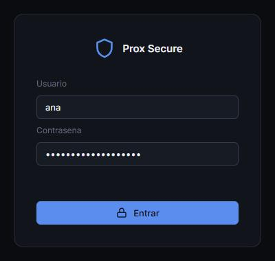
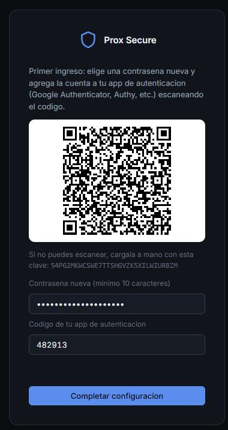
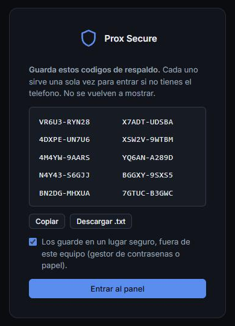
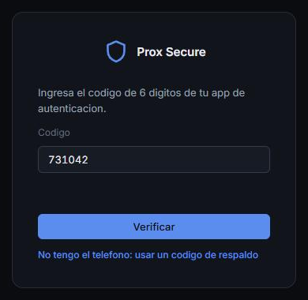
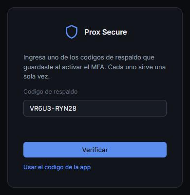
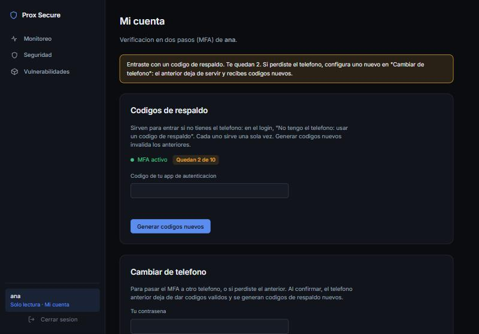
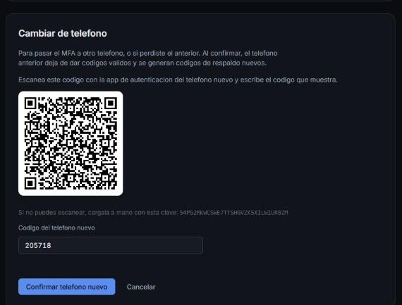

# Manual de usuario: verificación en dos pasos (MFA)

Para entrar a Shinji SOC se necesitan dos cosas: tu **contraseña** y un **código de 6 dígitos** que genera una app en tu teléfono y cambia cada 30 segundos. Así, aunque alguien consiga tu contraseña, no puede entrar sin tu teléfono.

- [Qué necesitas](#qué-necesitas)
- [Tu primer ingreso](#tu-primer-ingreso)
- [Ingresar cada día](#ingresar-cada-día)
- [Códigos de respaldo](#códigos-de-respaldo)
- [Mi cuenta](#mi-cuenta)
- [Perdí o cambié el teléfono](#perdí-o-cambié-el-teléfono)
- [Acciones que piden el código](#acciones-que-piden-el-código)
- [Problemas frecuentes](#problemas-frecuentes)
- [Para administradores](#para-administradores)

> Las capturas de esta guía usan una cuenta de ejemplo ("ana") y un código QR de prueba.

## Qué necesitas

Una app de autenticación en tu teléfono. Cualquiera que use códigos TOTP sirve, por ejemplo:

- Google Authenticator
- Microsoft Authenticator
- Authy
- 2FAS
- Aegis (Android)

Te conviene una que permita respaldar las cuentas o pasarlas a otro teléfono: si cambias de teléfono sin pasar la app, vas a necesitar tus [códigos de respaldo](#códigos-de-respaldo).

## Tu primer ingreso

Un administrador te crea la cuenta y te pasa tu usuario y una **contraseña temporal**.

**1. Entra** con tu usuario y la contraseña temporal.



**2. Agrega la cuenta a tu app de autenticación.** Abre la app, toca "Agregar" (o el botón **+**) y escanea el código QR de la pantalla.



Si no puedes escanear, elige en la app "Ingresar clave" y escribe la clave que aparece debajo del QR (tipo: basada en tiempo).

**3. Elige tu contraseña**, de al menos 10 caracteres. Desde ahora reemplaza a la temporal.

**4. Escribe el código de 6 dígitos** que muestra la app para "Shinji SOC" y toca **Completar configuración**.

**5. Guarda tus códigos de respaldo.** Aparecen una sola vez:



- **Copiar** los copia al portapapeles (el navegador solo lo permite si el panel se usa por `https://`).
- **Descargar .txt** baja un archivo con los 10 códigos.

Guárdalos fuera de este computador: en un gestor de contraseñas o impresos en papel en un lugar seguro. No los guardes en el mismo teléfono que tiene la app. Marca la casilla y toca **Entrar al panel**.

## Ingresar cada día

1. Escribe tu usuario y contraseña.
2. Abre la app de autenticación y escribe el código de 6 dígitos de "Shinji SOC".



Cada código dura 30 segundos. Si está a punto de cambiar, espera el siguiente.

La sesión dura 24 horas (lo puede cambiar el super admin). Después de 5 intentos fallidos, de contraseña o de código, la cuenta se bloquea 5 minutos.

## Códigos de respaldo

Son **10 códigos de un solo uso** (con la forma `XXXXX-XXXXX`) para entrar cuando no tienes el teléfono a mano: se te quedó, se quedó sin batería, se rompió o lo perdiste.

**Para usar uno:** en la pantalla del código, toca **No tengo el teléfono: usar un código de respaldo** y escribe uno de tus códigos. Da igual si usas mayúsculas o minúsculas, o si escribes el guion.



- Cada código sirve **una sola vez**. Táchalo de tu lista después de usarlo.
- Al entrar con uno, el panel te lleva a **Mi cuenta** y te avisa cuántos te quedan.
- Los códigos de respaldo sirven solo para entrar. Las [acciones que piden el código](#acciones-que-piden-el-código) siguen pidiendo el de la app.

**Para tener códigos nuevos:** en Mi cuenta, **Generar códigos nuevos** (pide un código de la app). Los anteriores dejan de servir. Hazlo cuando te queden pocos o si crees que alguien vio tu lista.

## Mi cuenta

Se abre tocando tu nombre de usuario, abajo en la barra lateral.



- **Códigos de respaldo:** cuántos te quedan sin usar y el botón para generar nuevos.
- **Cambiar de teléfono:** para pasar el MFA a otro teléfono (ver la sección siguiente).

## Perdí o cambié el teléfono

### Cambio de teléfono y todavía tengo el anterior

Lo más simple es usar la función de tu app para pasar las cuentas al teléfono nuevo. Si tu app no la tiene:

1. Entra al panel como siempre.
2. Ve a **Mi cuenta > Cambiar de teléfono** y escribe tu contraseña.
3. Escanea el QR nuevo con la app del **teléfono nuevo** y escribe el código que muestra.



Al confirmar, el teléfono anterior deja de dar códigos válidos y recibes 10 códigos de respaldo nuevos (los anteriores dejan de servir).

### Perdí el teléfono y tengo mis códigos de respaldo

1. Entra con tu usuario, tu contraseña y un **código de respaldo**.
2. En **Mi cuenta > Cambiar de teléfono**, configura la app en tu teléfono nuevo.

Con eso, quien encuentre tu teléfono anterior ya no puede generar códigos válidos.

### Perdí el teléfono y no tengo los códigos

- **Cuenta de solo lectura o admin:** pide a un administrador que use **Resetear acceso** en Usuarios. Te dará una contraseña temporal nueva, y en tu próximo ingreso harás de nuevo el [primer ingreso](#tu-primer-ingreso) con un QR nuevo. El teléfono perdido deja de servir.
- **Cuenta super admin:** no se puede resetear desde el panel. Quien tenga acceso a la terminal del servidor puede hacerlo así (cambia `TU_USUARIO` por el nombre de la cuenta):

  ```bash
  docker compose exec server python -c "
  import asyncio, sys
  from sqlalchemy import delete, select
  from app.core.db import SessionLocal
  from app.models.user import MfaRecoveryCode, User
  from app.services import auth

  async def main(name):
      async with SessionLocal() as db:
          u = (await db.execute(select(User).where(User.username == name))).scalar_one_or_none()
          if u is None:
              sys.exit('No existe el usuario ' + name)
          temp = auth.generate_temp_password()
          u.password_hash, u.must_set_password = auth.hash_password(temp), True
          u.mfa_secret, u.mfa_enabled = auth.generate_mfa_secret(), False
          u.failed_attempts, u.locked_until = 0, None
          await db.execute(delete(MfaRecoveryCode).where(MfaRecoveryCode.user_id == u.id))
          await db.commit()
          print('Contrasena temporal:', temp)

  asyncio.run(main('TU_USUARIO'))
  "
  ```

  Muestra una contraseña temporal. Con ella entras y haces de nuevo el primer ingreso, con QR y códigos de respaldo nuevos.

## Acciones que piden el código

Algunas acciones delicadas vuelven a pedir el código de la app, aunque ya hayas entrado:

- guardar cambios en **Configuración**;
- generar un token nuevo o **Cerrar todas las sesiones**;
- **eliminar** un servidor;
- **Dar acceso** a un log desde la página de un servidor;
- generar códigos de respaldo nuevos.

Para estas acciones no sirven los códigos de respaldo: hace falta la app.

## Problemas frecuentes

**"Código inválido" aunque lo escribo bien.** Los códigos dependen de la hora. Activa la hora automática en el teléfono (en Android: Ajustes > Fecha y hora > Automática; en iPhone: Configuración > General > Fecha y hora > Ajustar automáticamente). El servidor acepta el código anterior y el siguiente, así que un desfase de unos segundos no importa.

**"Cuenta bloqueada temporalmente".** Hubo 5 intentos fallidos seguidos. Espera 5 minutos.

**"Sesión de login expirada".** Entre la contraseña y el código pasaron más de 10 minutos. Vuelve a empezar.

**El botón Copiar dice que el navegador no dejó copiar.** Pasa cuando el panel se usa por `http://`. Usa **Descargar .txt**.

**En la app la cuenta aparece como "Prox Secure".** Es el nombre anterior del proyecto. La cuenta sigue funcionando igual; si quieres, puedes renombrarla en la app.

## Para administradores

**Resetear acceso** (en Usuarios) da una contraseña temporal nueva y borra el MFA de la cuenta: en su próximo ingreso la persona escanea un QR nuevo y recibe códigos de respaldo nuevos. Úsalo cuando alguien olvidó su contraseña o perdió su teléfono.

| Quién puede resetear | A quién |
|---|---|
| super admin | cuentas admin y de solo lectura |
| admin | cuentas de solo lectura |
| nadie desde el panel | la cuenta super admin (ver [Perdí el teléfono y no tengo los códigos](#perdí-el-teléfono-y-no-tengo-los-códigos)) |

La contraseña temporal se muestra una sola vez: pásala por un canal seguro (no por el mismo correo o chat donde está el usuario).

Las cuentas creadas antes de que existieran los códigos de respaldo no tienen códigos: cada persona los genera en **Mi cuenta > Generar códigos nuevos**.
